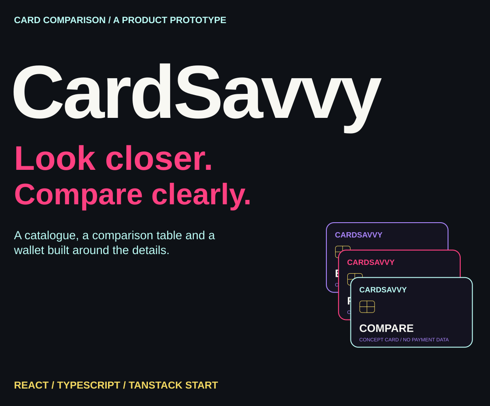
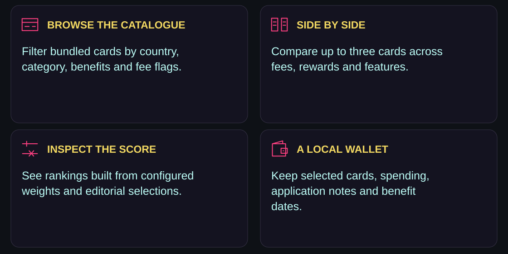
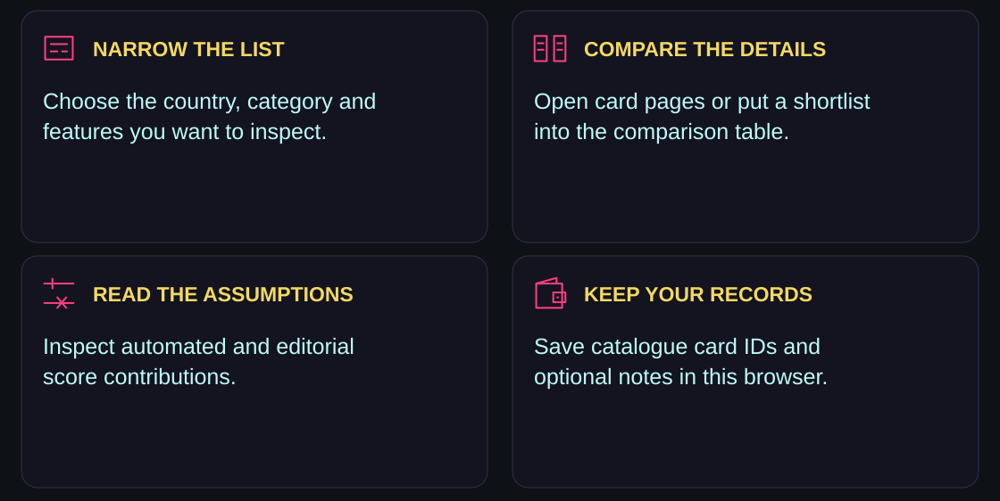
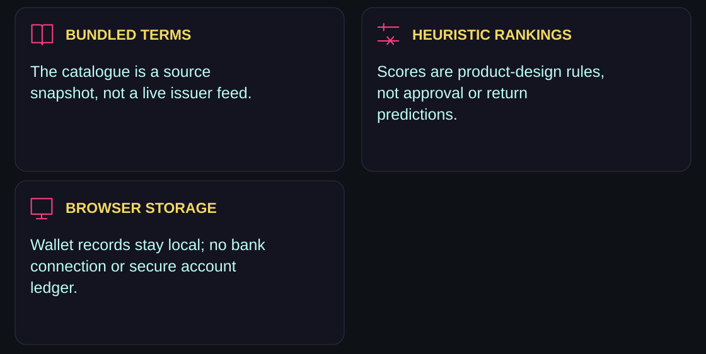
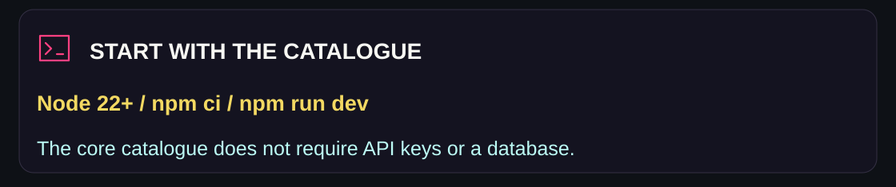
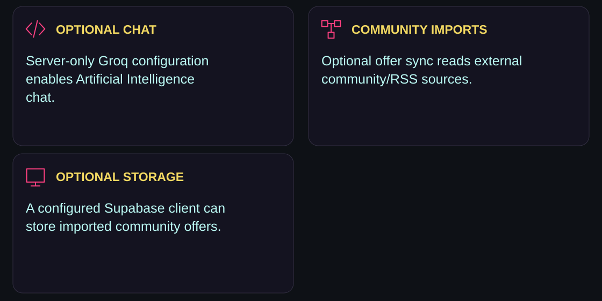
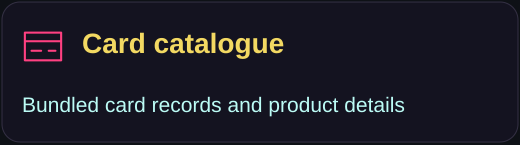
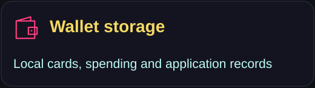
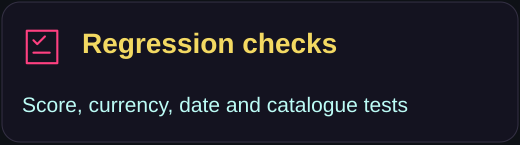
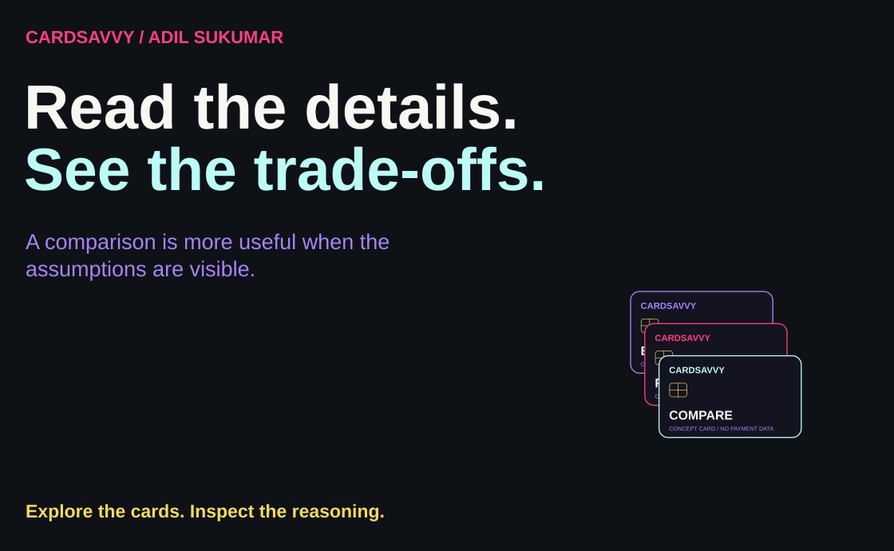

<p><picture><source media="(max-width: 600px)" srcset="assets/readme/hero-mobile.svg"/></picture></p>

<p align="center"><a href="#what-i-built">Overview</a> · <a href="#from-catalogue-to-shortlist">Workflow</a> · <a href="#what-the-rankings-mean">Scores</a> · <a href="#run-locally">Run locally</a> · <a href="#optional-integrations">Integrations</a> · <a href="#explore-the-source">Source</a></p>

CardSavvy is my credit-card comparison and wallet prototype. I built it around a bundled catalogue, a side-by-side comparison view and rankings whose rules can be inspected in the source. The core experience works without API credentials or a database.

[Open the existing live application](https://cardsavvy-adil-sukumar.vercel.app/)

<a id="what-i-built"></a>

##  What I built

<p><picture><source media="(max-width: 600px)" srcset="assets/readme/features-mobile.svg"/></picture></p>

Browse card details and issuer links, filter by country and category, or inspect features such as lounge access and foreign-exchange fees. The wallet keeps selected catalogue cards, spending entries, application status notes and benefit-expiry records in browser storage.

<a id="from-catalogue-to-shortlist"></a>

##  From catalogue to shortlist

<p><picture><source media="(max-width: 600px)" srcset="assets/readme/workflow-mobile.svg"/></picture></p>

Comparison uses up to three selected card IDs in the route’s search state. The table gathers their features so differences can be read together. Country/category rankings use the same scoring module rather than a separate hidden model.

<a id="what-the-rankings-mean"></a>

##  What the rankings mean

<p><picture><source media="(max-width: 600px)" srcset="assets/readme/scope-mobile.svg"/></picture></p>

Scores combine weighted benefits, reward-rate bonuses, fee penalties and editorial selections. Category-specific weights change the ranking emphasis. `scoreBreakdown()` exposes the automated, editorial and total components; the final score is capped at 100.

These are product-design heuristics, not a trained credit model, an approval prediction or a verified estimate of financial return. Currency multipliers are fixed reference assumptions in [scoring.ts](src/lib/scoring.ts), not live exchange rates. Catalogue terms and issuer links may be outdated; check current eligibility, rates and offers with the issuer.

The wallet is a local record-keeping feature, not a secure banking ledger. Do not enter card numbers, CVVs, passwords or bank credentials. Records are scoped to the browser/site storage and are not synchronized with your bank.

<a id="run-locally"></a>

##  Run locally

<p><picture><source media="(max-width: 600px)" srcset="assets/readme/environment-mobile.svg"/></picture></p>

Use **Node.js 22 or later** and npm:

```sh
git clone https://github.com/adilsukumar/CardSavvy.git
cd CardSavvy
npm ci
npm run dev
```

Open the local URL printed by Vite. The core catalogue does not require `.env` values. Optional integrations are listed in [.env.example](.env.example).

### Project checks

```sh
npm test
npm run typecheck
npm run build
```

Existing tests cover currency-normalized beginner scoring, repeated features, ranking without source-order mutation, date labels and score bounds across catalogue categories. They check implementation regressions, not issuer-term accuracy or financial outcomes.

### Build and deploy

The app uses React 19, TypeScript, TanStack Start/Router, Tailwind CSS and Radix/shadcn components. It builds a server-rendered application. Use a compatible server/adapter rather than assuming a static-only host can run the server functions.

For Vercel, import this repository, use Node 22 or later and keep `npm run build` as the build command. The Nitro Vercel preset in [vite.config.ts](vite.config.ts) emits `.vercel/output`, including server functions. Do not commit build output, `.vercel` or credentials.

<a id="optional-integrations"></a>

##  Optional integrations

<p><picture><source media="(max-width: 600px)" srcset="assets/readme/services-mobile.svg"/></picture></p>

| Variable | Role |
|---|---|
| `GROQ_API_KEY` | Server-only Artificial Intelligence chat; never prefix it with `VITE_` |
| `VITE_SUPABASE_URL` | Optional public Supabase project URL for offer storage |
| `VITE_SUPABASE_ANON_KEY` | Optional public client key; use appropriate database RLS policies |

Without the Groq key, chat returns an explanation that it is unconfigured. The server function validates bounded conversation input and can query the bundled catalogue or attempt external web retrieval during generation. Submitted conversations go to the configured provider. Before enabling chat on a public deployment, add application authentication, rate limiting and provider-budget controls.

Community-offer sync reads external Reddit/RSS services and can optionally store results in Supabase. These imports are community posts, not verified issuer offers. The importer does not invent expiry dates when the source has none. Never use a Supabase service-role key in browser configuration.

The existing public edition leaves optional chat and database services unconfigured. Filters, comparison, details, rankings and the browser-local wallet remain available without them.

<a id="explore-the-source"></a>

##  Explore the source

<p align="center"><a href="src/lib/scoring.ts"></a> <a href="src/data/cards.ts"></a> <a href="src/lib/wallet.ts"></a> <a href="tests/scoring.test.mjs"></a></p>

| Area | Source |
|---|---|
| Browse and filter | [cards.tsx](src/routes/cards.tsx) |
| Comparison table | [compare.tsx](src/routes/compare.tsx) |
| Page routes and card detail views | [src/routes/](src/routes/) |
| Optional chat and external retrieval | [chat.ts](src/lib/api/chat.ts) |
| Community import | [scraper.ts](src/lib/api/scraper.ts) |
| Server-rendered deployment configuration | [vite.config.ts](vite.config.ts) |

<details>
<summary><strong>Public-edition implementation notes</strong></summary>

- Provider credentials and shared database configuration were removed from the source.
- Optional integrations use environment configuration; chat input is bounded.
- Currency-normalized beginner scoring and duplicate feature weighting have regression coverage.
- Future-date labels and malformed local-storage arrays are handled.
- Community imports keep missing expiry dates missing.
- The repository keeps application source and a single npm lockfile, rather than generated builds, installed packages or one-off experiments.

</details>

<p><picture><source media="(max-width: 600px)" srcset="assets/readme/closing-mobile.svg"/></picture></p>

<p align="center"><a href="https://github.com/adilsukumar/CardSavvy/issues">Discuss an improvement</a> · <a href="src/lib/scoring.ts">Inspect the scoring</a> · <a href="https://www.adilsukumar.xyz/">Meet the builder</a></p>
